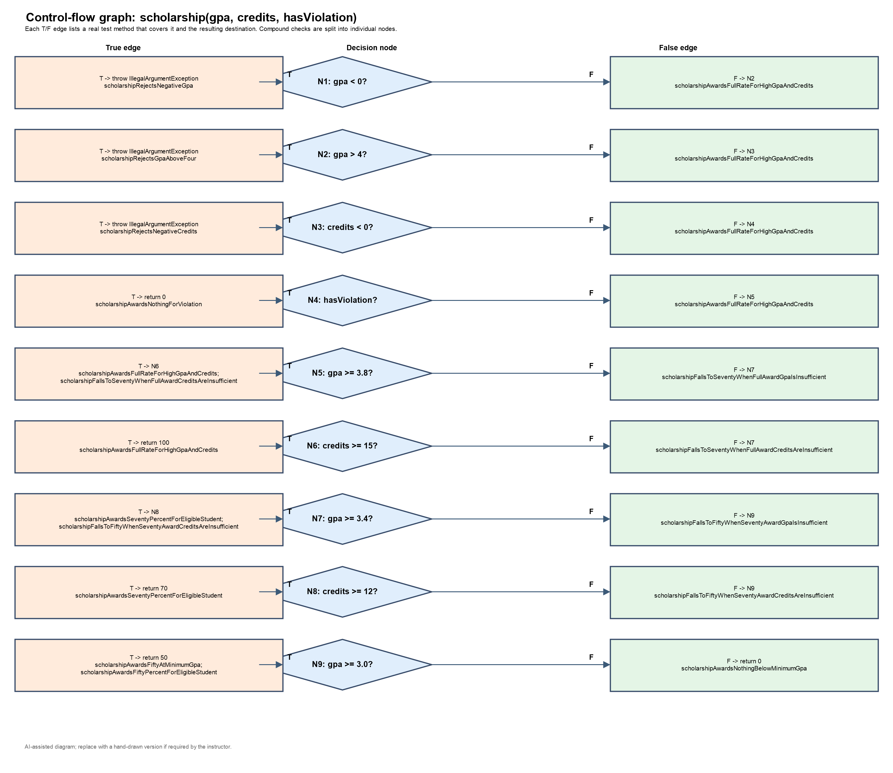

# Lab 09: JaCoCo Coverage

**Name:** ANAR BATBOLD  
**Student code:** B170910823

## Environment

`java -version`:

```text
openjdk version "17.0.21.0.2" 2026-10-22 LTS
OpenJDK Runtime Environment Microsoft-15779939 (build 17.0.21.0.2+1-LTS)
OpenJDK 64-Bit Server VM Microsoft-15779939 (build 17.0.21.0.2+1-LTS, mixed mode, sharing)
```

`mvn -version`:

```text
Apache Maven 3.9.16 (2bdd9fddda4b155ebf8000e807eb73fd829a51d5)
Maven home: C:\apache-maven-3.9.16
Java version: 17.0.21.0.2, vendor: Microsoft, runtime: C:\Program Files\Microsoft\jdk-17.0.21.21-hotspot
Default locale: en_US, platform encoding: Cp1252
OS name: "windows 11", version: "10.0", arch: "amd64", family: "Windows 11"
```

## A — Happy-path baseline

The five initial tests cover a high score, a two-grade GPA, and each scholarship award tier. `results/mvn-verify-A.txt` records 5 passing tests. From `results/jacoco-A.csv`, `ScholarshipCalculator` has 16/25 lines covered (64.0%) and 22/41 branches covered (53.7%).

The yellow lines are partially covered compound checks: score/GPA/credit validation, the GPA empty-input guard, and scholarship eligibility conditions. Red lines include invalid-input exception bodies, lower letter grades and the F switch path, and the no-award fallback. These are paths the happy-path examples never execute.

## B — CFG and complete coverage



The diagram labels each branch with the exact test method that exercises it. It was generated with AI assistance, not hand-drawn; the assignment asks for a hand-drawn CFG, so this image does not claim to satisfy that particular presentation requirement.

The expanded suite has 26 passing tests in `results/mvn-verify-B.txt`. `results/jacoco-B.csv` reports `BRANCH_MISSED = 0` and `LINE_MISSED = 0` (41/41 branches and 25/25 lines covered). Separate exception tests exercise each true operand of the scholarship input-validation `||` condition.

## C — Loop-boundary cases

The loop is tested with zero iterations (`gpaEmptyArrayRepresentsZeroIterations`, which asserts the empty-array exception), one iteration (`gpaCalculatesOneIteration`), and multiple iterations (`gpaCalculatesMultipleIterations`); the null-array exception is also covered by `gpaRejectsNullScores`. The suite still reports 0 missed branches and 0 missed lines because these tests exercise loop cardinalities already represented in the CFG; they remain valuable because they check behavior for empty, singleton, and larger collections rather than merely whether each structural path ran.

## D — Boundary defect reproduced

The boundary test `letterGradeReturnsDAt60` fails in `results/mvn-test-D-fail.txt` with `expected: <D> but was: <F>`. The implementation checks `score > 60`, although the specification includes 60 in the D range; the separate fix and final verification are recorded in the next commit.

## AI assistance

GitHub Copilot was used to help implement and run the tests, calculate coverage from JaCoCo CSV output, and prepare the control-flow diagram. The results and explanations are based on the code and command outputs in this repository.
